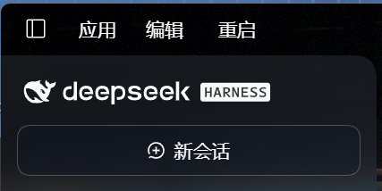

# dsh-restart-menu

给 DeepSeek Harness 桌面版加一枚「重启」按钮，位置就在左上角 **应用 / 编辑** 的右边。

点一下，整个应用会自动关掉并重新打开 —— 不用再点「退出」、不用再去右下角托盘里彻底结束进程、也不用回桌面重新双击图标。



> 截图里 `应用 / 编辑 / 重启` 三个按钮并排：前两个是 DSH 原生的，第三个「重启」由本插件注入，样式、悬停、点击手感和原生完全一致。

## 为什么不是「应用」菜单里的一项

「应用」下拉是 Electron 主进程里用固定模板（`applicationItems()`）画出来的原生菜单，插件运行在 DSH Host 进程里，**没有任何扩展点**。想在菜单里真正加一行，只能去改 `app.asar`（社区里的做法是等长补丁），代价是每次 DSH 升级都可能失效，还可能损坏安装。

所以本插件走的是无侵入路线：在标题栏那排按钮后面追加一个同款按钮，视觉和交互都跟原生菜单一致，但不碰任何安装文件。

## 安装

- 在 DSH 插件市场里搜索 `dsh-restart-menu` 安装；或
- 在 profile 里安装：`dsh plugin add dsh-restart-menu`；或
- 用本包自带的索引手动添加来源（见下）。

### 用自带索引添加来源

包内 `market/index.json` 是一份合法的市场索引（format 1，只含本插件）。它随包发布到 npm，可以直接当作「插件索引」来源：

```
https://unpkg.com/dsh-restart-menu/market/index.json
```

打开 DSH 的插件市场 → 在索引来源里「添加插件索引」→ 粘贴上面的地址 → 刷新，就能看到本插件的卡片并一键安装。这个地址始终指向最新版本；想锁定版本就写成 `https://unpkg.com/dsh-restart-menu@0.1.1/market/index.json`。

这样上架不依赖任何 GitHub 仓库。

**首次生效需要重启一次应用**（装完插件后 DSH 还没加载它，这是所有插件的共同限制）。

## 使用

点标题栏上的「重启」：

1. 按钮变成「重启中…」；
2. 约 1.5 秒后应用窗口关闭（**不会闪出黑色控制台窗口**）；
3. 约 2~3 秒后自动重新打开，会话、工作区、正在编辑的内容都还在（DSH 会持久化会话）。

如果窗口关掉后一直没回来，或者按钮变成「重启未生效」，看日志：

```
%TEMP%\dsh-restart-menu.log
```

日志里每一步都有记录（`taskkill exit=0` / `image stopped` / `launching (attempt 1)` / `launched`），能直接看出卡在哪一步。

## 它是怎么工作的

- **Host 半侧**（`lib/index.js`）在 DSH Web 服务器上注册 `POST /plugins/dsh-restart-menu/restart`，只接受本机回环地址 + 自定义确认头；
- **Client 半侧**（`lib/client.js`）往桌面标题栏那排按钮（preload 的 open shadow root）里追加「重启」；
- 点击后 Host 在 `%TEMP%` 写一个 detached 的 VBScript helper（`dsh-restart-menu-helper.vbs`），用 `wscript.exe //B` 跑起来，helper 会：
  1. 等 1.5 秒，让 HTTP 响应先回到页面；
  2. `taskkill /F /IM "DeepSeek Harness.exe"` 结束整个应用（隐藏窗口执行）；
  3. 轮询 `tasklist` 确认进程真的退出（最多 20 秒，通常 1 秒内）；
  4. 用 `explorer.exe "<安装目录>\DeepSeek Harness.exe"` 拉起——和双击桌面图标走同一条 ShellExecute 路径，所以新窗口一定可见；
  5. 最多尝试 5 次拉起（防止旧进程没退干净时被单实例锁弹掉）；
  6. 每一步都写日志。

  用「按映像名结束 + 外部拉起」而不是 `app.relaunch()`，是因为插件拿不到 Electron 主进程的控制权；helper 用 detached 启动，所以它在结束应用时不会被一起结束。

  **为什么是 VBScript 而不是 .cmd**：批处理必须带控制台窗口；从隐藏的控制台里 `start` 出来的应用会继承「隐藏窗口」状态，结果进程起来了但窗口看不见。`wscript.exe` 是 GUI 子系统、完全没有控制台，也不会把隐藏状态传下去——这同时解决了黑框和「重启后没窗口」两个问题。

安全性：helper 在动手前会确认可执行文件存在；只有本机、只有带确认头的请求才能触发；非桌面环境（网页版）会直接返回 409，不会误杀进程。

## 兼容性

- 仅 **Windows 桌面版**（按钮挂在 Windows 标题栏菜单上；macOS 的原生菜单栏没有可注入的 DOM）。
- DSH `0.2.1-rc.3` ~ `0.2.2-rc.1` 已验证。

## 卸载

在插件市场里卸载，或从 profile 的 `dsh.profile.bundles` 里移除 `dsh-restart-menu`，重启应用即可。
`%TEMP%` 下的 helper 与日志可以直接删除。

## License

MIT
